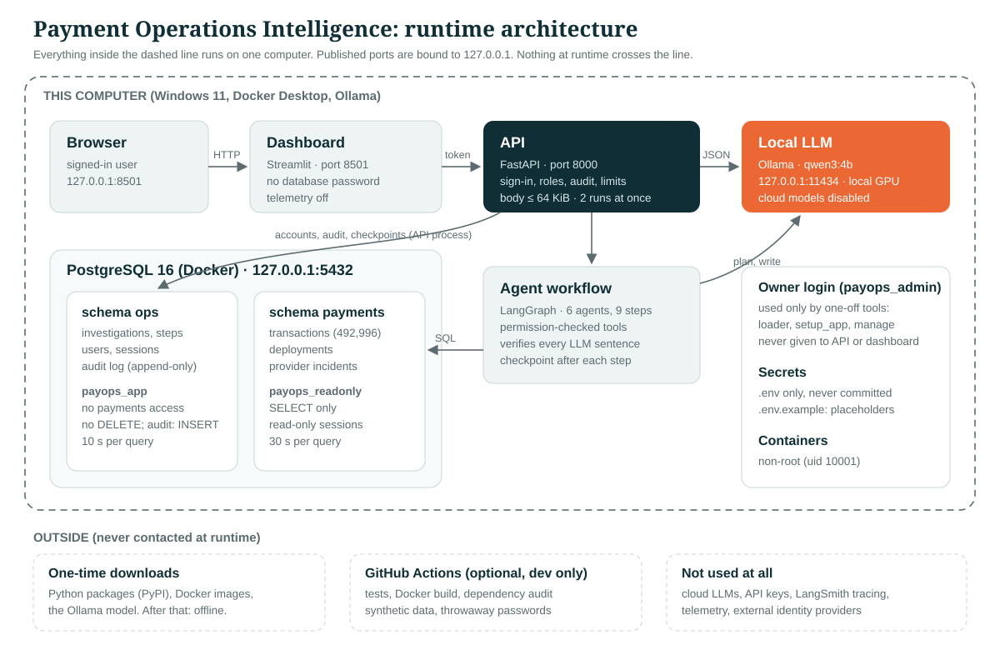

# Architecture

How the parts fit together, and why. For the agents' internals see `docs/agent_design.md`; for accounts, roles and the audit log see `docs/security.md`; for every file see `docs/file_guide.md`.

`docs/architecture.svg` is plain SVG text, so you can edit it in any text editor or in Inkscape (free, local).

## The one rule the layout follows

**Everything the application needs at runtime runs on this computer.** The internet is used only to download software once (Python packages, Docker images, the Ollama model) and, optionally, by GitHub Actions for CI, which never runs the application against real data. `docs/offline_checklist.md` lists how each part of this is checked.

## Components

| Component | Technology | Listens on | Talks to | Holds |
|---|---|---|---|---|
| Browser | any | — | Dashboard | nothing |
| Dashboard | Streamlit | 127.0.0.1:8501 | API only | a session token per signed-in user; no database password |
| API | FastAPI (uvicorn) | 127.0.0.1:8000 | database, Ollama | read-only and application logins |
| Agent workflow | LangGraph, inside the API process (or the CLI) | — | database via tools, Ollama | per-run state |
| Local LLM | Ollama, `qwen3:4b` | 127.0.0.1:11434 | nothing | model weights |
| Database | PostgreSQL 16 in Docker | 127.0.0.1:5432 | nothing | schema `payments`, schema `ops` |
| One-off tools | Python CLI modules | — | database | owner login, only while they run |

## Request path: one investigation

1. The user signs in on the dashboard. The API checks the password (scrypt) and returns a random session token; the database keeps only its SHA-256.
2. The user asks a question. The dashboard sends it to `POST /api/v1/investigations` with the token.
3. The API checks the token, the role (`investigations:run`), the body size and the concurrency limit, and writes an audit row.
4. The LangGraph workflow runs nine steps: plan → transaction, pattern, forecast (in parallel) → impact → assemble → narrate → verify → finalize. After each step, its output is saved as a JSON checkpoint in `ops.investigation_steps`.
5. The agents read payment data only through permission-checked tools that run parameterised SQL under the read-only login. Every call is recorded and every finding cites its calls.
6. The LLM is used twice: to propose a plan (validated by code) and to write the report from the findings (checked sentence by sentence by the Verification agent). If either fails, a clearly labelled template report is used.
7. The API returns the report, the findings, the verification result and the trace. The dashboard shows them with the evidence next to every sentence.

## Data boundaries

| Login | Used by | Can | Cannot |
|---|---|---|---|
| `payops_readonly` | agents, analytics, `/health` | SELECT on `payments.*`, read-only sessions, 30 s per query | write anything; see `ops.*` |
| `payops_app` | API (history, accounts, audit) | SELECT/INSERT/UPDATE on `ops` tables; INSERT on the audit log; 10 s per query | see `payments.*`; DELETE; change the audit log |
| `payops_admin` (owner) | loader, `setup_app`, `manage` | everything | — never given to the API or dashboard containers |

## Two ways to run it

| | Development (venv) | Packaged (Docker) |
|---|---|---|
| Database | Docker | Docker |
| API, dashboard | native Python, from the venv | containers built from this folder, non-root (uid 10001) |
| LLM | native Ollama, uses the GPU | template report by default; opt-in to use native Ollama (`docs/runbook.md`) |
| Start | README sections 2–5 | README section 6a |

## Design decisions and their trade-offs

| Decision | Why | Trade-off |
|---|---|---|
| Numbers from SQL and Python, never from the LLM | Small local models make arithmetic and copying errors; code is testable | The LLM can only phrase, so reports read a little mechanically |
| Verification removes sentences, and above 30 % removed uses the template | A partly wrong report is worse than a plain one | Some true sentences get removed (measured: `docs/evaluation.md`) |
| Own JSON checkpoints instead of LangGraph's checkpointer | Validated JSON, never unpickled objects; per-step reuse rule we can test | No LangGraph human-in-the-loop or time-travel features |
| Server-side sessions instead of JWTs | Logout, disabling and role changes take effect immediately | One database read per request |
| Local accounts, no identity provider | Project rule: no external accounts | No single sign-on; passwords managed here |
| One Docker image for API, dashboard and tools | One build, one dependency set | The dashboard image carries packages it doesn't use |
| PostgreSQL instead of SQLite | Separate logins, read-only sessions, statement timeouts, append-only triggers | Needs Docker |
| No vector store or RAG | All the evidence is structured; SQL answers it exactly | Free-text incident notes would need one |

## Limits that keep a run bounded

Time per investigation 600 s, 20 graph steps (9 needed), 30 tool calls per agent step (the busiest uses 9), 4 LLM calls per investigation, 180 s per LLM reply, 2 investigations at once (HTTP 429 after that). Details and what happens when each is reached: `docs/agent_design.md`.
